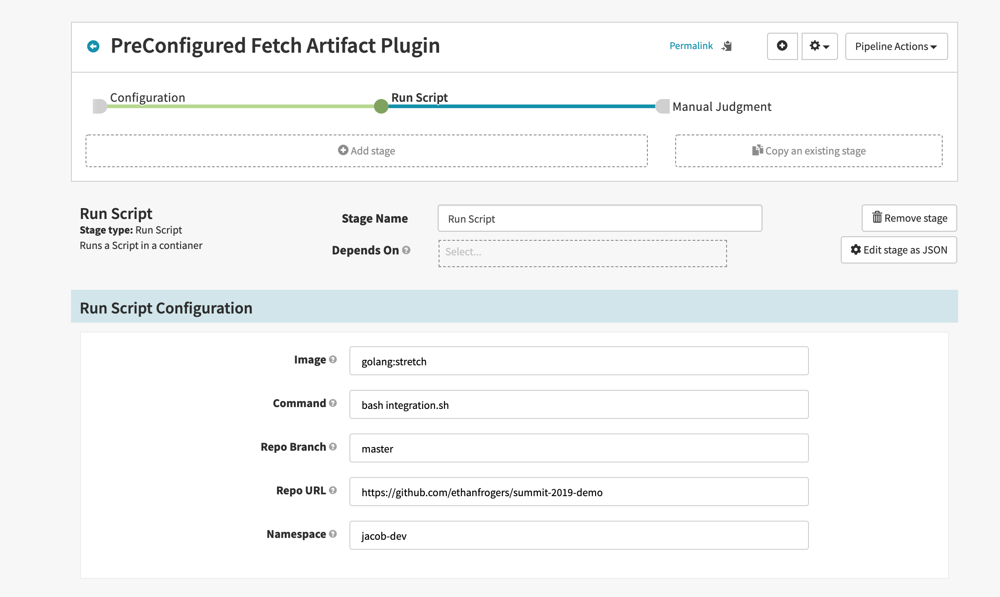
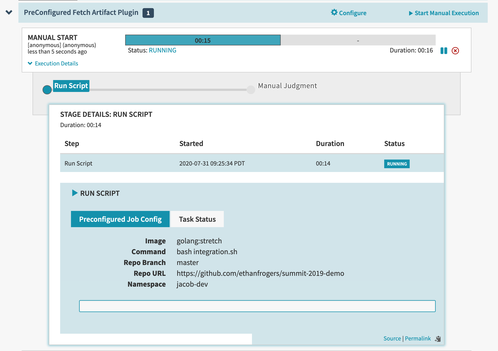
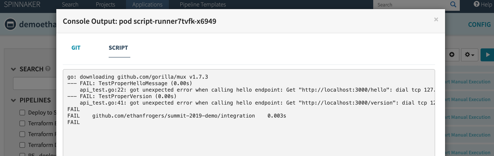

# ARCHIVED

Spinnaker supports run jobs via the current K8s path including for predfined jobs.  Enhancements LIKE automatic artifact fetches would be a nice to have in the core codebase.  This plugin
doesn't support nor work securely today and isn't in known use.  We're archiving this at this time.  For questions, or interest, please see the [spinnaker community](https://spinnaker.io) or
contact [harness sales](sales@harness.io) for assistance on this.


# run-script-plugin

_Note: This plugin is under active development and subject to change. Use with caution until there has been
a 1.0 release._

The `run-script-plugin` provides Spinnaker with a preconfigured job stage that allows the operator to run a custom script. This is useful if you need to run an arbitrary script and use the output as part of your pipeline.

## Screenshots




## Installation
TODO

## Configuration
Sample Configuration:
```
spinnaker:
  extensibility:
    plugins:
      Armory.PreConfiguredJobPlugin.RunScript:
        enabled: true
        config:
          account: kubernetes
          credentials: kubernetes
          artifactServiceUrl: http://spin-clouddriver.prod:7002
          gitArtifactAccount: gitrepo
        # Optional: override default init container image 
          initContainerImage: myrepo/fetch-artifact:latest 
```

# Development

## Release

At this time, the process of creating a new release for the run-script-plugin is as follows:
- Create and push a new release tag (ie `v0.0.1`). This will kick off the appropriate action to create a gh release and open a PR to the plugins repository.
- Navigate to the plugins repository pull requests and merge the update (https://github.com/armory-plugins/pluginRepository/pulls)
